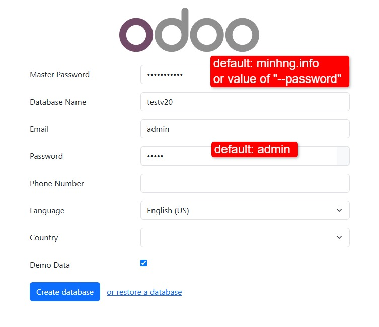
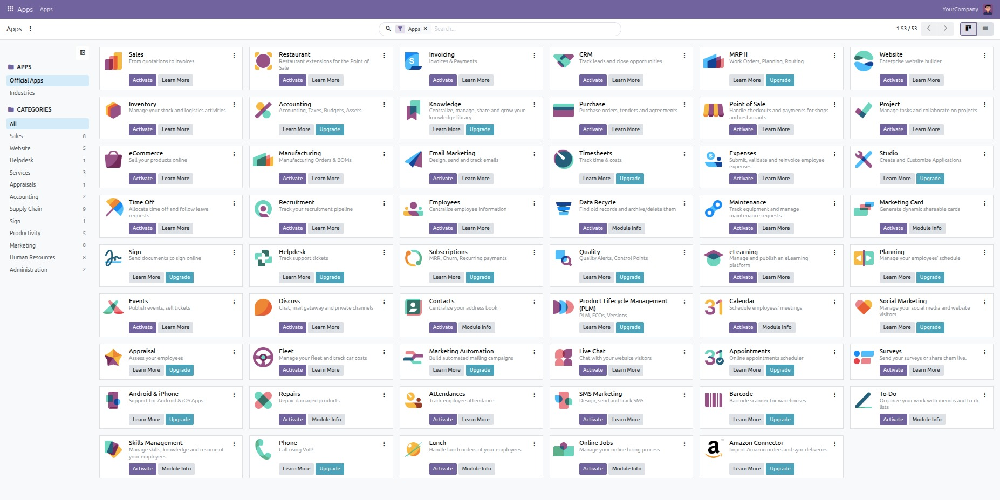
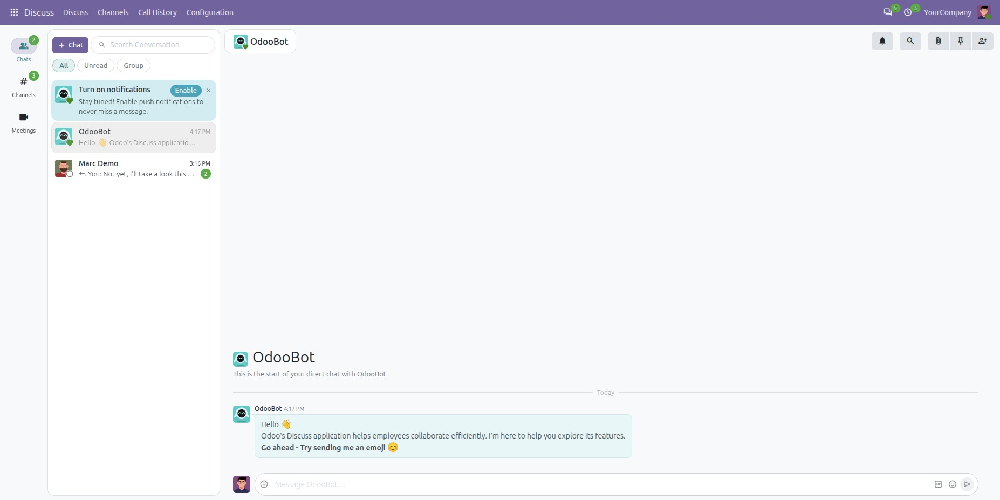
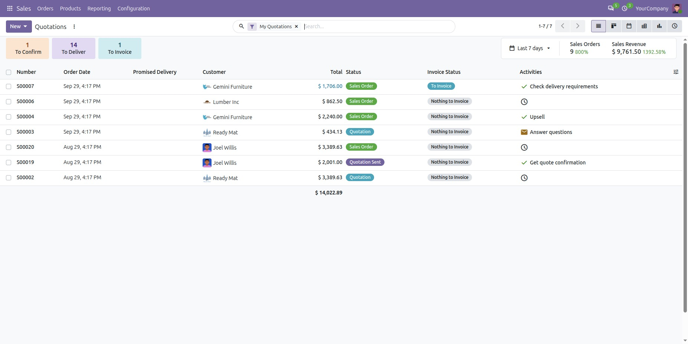
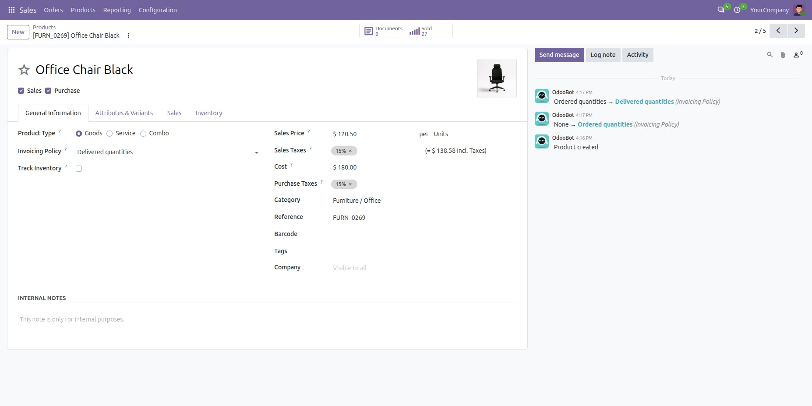

# Installing Odoo 20 (2026 release)

> Based on [minhng92/odoo-20-docker-compose](https://github.com/minhng92/odoo-20-docker-compose) (MIT, © 2026 Minh Nguyen).
> Maintained here by Delta Aplicación with our own defaults; see [LICENSE](LICENSE).

Set up **Odoo 20** in a single command using Docker Compose — with support for running multiple Odoo instances on one server.

> **Passwords are generated at install time.** `run.sh` creates a random 28-character master
> password and a random database password, and prints both when it finishes. Pass `--password`
> and `--db-password` if you want to choose them yourself.

## Quick Start

Install [Docker](https://docs.docker.com/get-docker/) and [Docker Compose](https://docs.docker.com/compose/install/) first, then run the following to set up your first Odoo instance at `localhost:10020`:

```bash
curl -s https://raw.githubusercontent.com/dougrvd/Odoo_OnPremise20/main/run.sh \
  | bash -s -- --destination odoo-one --port 10020 --chat 20020
```

and/or run the following to set up another Odoo instance at `localhost:11020`:

```bash
curl -s https://raw.githubusercontent.com/dougrvd/Odoo_OnPremise20/main/run.sh \
  | bash -s -- --destination odoo-two --port 11020 --chat 21020
```

If `curl` is missing, install it:

```bash
sudo apt-get install curl     # Debian / Ubuntu
sudo yum install curl         # RHEL / CentOS
```

### Arguments

| Flag | Required | Example | Meaning |
|------|:--------:|---------|---------|
| `--destination` | Yes | `odoo-one` | Name of the deploy folder where the stack is cloned |
| `--port` | Yes | `10020` | Odoo web port exposed on the host |
| `--chat` | Yes | `20020` | Live-chat port exposed on the host |
| `--password` | No | `mymaster` | Odoo master password (**admin_passwd**). Defaults to the value in **etc/odoo.conf** |
| `--db-password` | No | `dbSecret` | PostgreSQL password (**POSTGRES_PASSWORD**/**PASSWORD**). Defaults to `odoo20@2026` |

### Examples with custom passwords

Custom master password:

```bash
curl -s https://raw.githubusercontent.com/dougrvd/Odoo_OnPremise20/main/run.sh \
  | bash -s -- --destination odoo-one --port 10020 --chat 20020 --password mymaster
```

Custom master + database passwords:

```bash
curl -s https://raw.githubusercontent.com/dougrvd/Odoo_OnPremise20/main/run.sh \
  | bash -s -- --destination odoo-one --port 10020 --chat 20020 \
    --password mymaster --db-password dbSecret
```

## Usage

Start the container:

```bash
cd odoo-one
docker-compose up -d
```

Then open <http://localhost:10020> to access Odoo 20.

## Tips & Troubleshooting

### Fix permission issues

If the container can't read your folders, open them up:

```bash
sudo chmod -R 777 addons etc postgresql
```

### Change the Odoo port

Edit **docker-compose.yml** in the parent directory:

```yaml
ports:
  - "10020:8069"
````

### Run in detached mode

Keep Odoo running after you close the terminal:

```bash
docker-compose up -d
```

### Set a restart policy

In **docker-compose.yml**, set the `restart` key on a service to one of:

- `no` — don't restart
- `on-failure[:max-retries]` — restart on crash, optionally capped
- `always` — always restart
- `unless-stopped` — always restart, except when stopped by you

```yaml
restart: always   # run as a service
```

### Run multiple instances on one machine

Raise the inotify watch limit (Ubuntu) to avoid errors when several instances watch the same tree:

```bash
if grep -qF "fs.inotify.max_user_watches" /etc/sysctl.conf; then
  echo $(grep -F "fs.inotify.max_user_watches" /etc/sysctl.conf)
else
  echo "fs.inotify.max_user_watches = 524288" | sudo tee -a /etc/sysctl.conf
fi
sudo sysctl -p
```

## Custom Addons

Drop your own addons into the **addons/** folder. It's mounted into Odoo as `/mnt/extra-addons`, so they load automatically.

## Loading Enterprise Addons

You can load Odoo enterprise addons into this project like this:

1. Create a new folder named **enterprise** inside **addons**, and put the enterprise addons in **addons/enterprise**.
2. Append the path to **addons_path** in the config file at **etc/odoo.conf** (the enterprise folder lives under the same mounted **addons/** folder, so use the container path `/mnt/extra-addons/enterprise`).
3. Restart the Odoo container (or down and up the Odoo container again):

   ``` bash
   docker-compose restart
   # or
   docker-compose down
   docker-compose up -d
   ```

Deploy Odoo enterprise with docker-compose in a **separate directory**, without running the Odoo community database(s) there. After deploying the enterprise version, create a **new enterprise database** and import data from the community version (if you have a running community instance).

## Configuration & Logs

- **Configuration:** edit [`etc/odoo.conf`](etc/odoo.conf)
- **Server log:** `etc/odoo-server.log`
- **Master password:** `etc/odoo.conf` ships the placeholder `CAMBIAR_ESTA_CLAVE`, not a usable password — this repository is public, so anything written here is public too. `run.sh` replaces it with a random one at install time. If you deploy by hand with `docker compose`, set it yourself before exposing the instance: that password allows creating, dropping and restoring databases.

## Container Management

| Action  | Command                 |
|---------|-------------------------|
| Run     | `docker-compose up -d`  |
| Restart | `docker-compose restart`|
| Stop    | `docker-compose down`   |

## Live Chat

The live-chat port (default **20020**) is exposed on the host. Behind a reverse proxy (e.g. nginx), forward `/longpolling/`:

```nginx
server {
  # ...
  location /longpolling/ {
    proxy_pass http://0.0.0.0:20020/longpolling/;
  }
  # ...
}
```

## Image versions

`docker-compose.yml` pins the exact images instead of the floating `odoo:20` / `postgres:18` tags:

| Service | Image | Version |
|---|---|---|
| Odoo | `odoo:20.0-20260926` | Odoo Server 20.0, build of 26 Sep 2026 |
| PostgreSQL | `postgres:18.6` | PostgreSQL 18.6 |

A moving tag means two installs made a month apart can ship different binaries, and recreating a container can bump the version without warning.

To move to a newer build, change the tag here, deploy it on a test instance first, and only then roll it out.

## Versions

| Service     | Image        |
|-------------|--------------|
| Odoo        | `odoo:20`    |
| PostgreSQL  | `postgres:18`|

## Screenshots

<p align="center">

</p>

<p align="center">

</p>

<p align="center">

</p>

<p align="center">

</p>

<p align="center">

</p>

---

